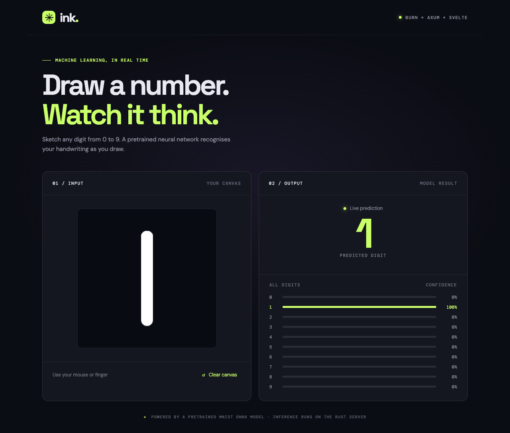

# Ink

Draw a digit and watch the app guess it as you draw. The canvas is built with Svelte; Rust, Axum, and Burn run the recognition using a [pretrained MNIST model](https://github.com/onnx/models/tree/main/validated/vision/classification/mnist).



## Run it

Start the backend from this folder:

```sh
cargo run
```

In another terminal, start the frontend:

```sh
cd frontend
bun install
bun run dev
```

Open the address Vite prints, usually <http://127.0.0.1:5173>. Draw a number from 0 to 9, or use **Clear canvas** to try again.
